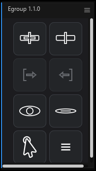

# Egroup

基于 EffectCraft 的组工具（仅整理）。

一个独立实现的图层分组面板：不改变图层的父子关系，不注入表达式，只把一组图层当作一个可折叠、可开关、可整体操作的对象来管理。

> 独立实现，不包含 Free Compose 的代码，也不依赖任何第三方脚本。



## 功能

- **建组**：选中若干图层，点击加号，在上方创建一个 `Group: N` 空对象。
- **释放组**：删除组空对象，组内图层保持原样。
- **加入 / 移出组**：选中组空对象和若干图层后按钮可用；加入只改归属，不移动图层，图层留在原位；移出同样不移动图层。
- **显示 / 隐藏**：切换组内图层的时间线 shy 状态，不修改图层原来的可见性开关。
- **全选组内层**：选中组空对象和所有成员。
- **自适应停靠**：横向、竖向、宽窄不同的停靠尺寸都会自动排成网格，图标随之缩放。
- **设置**：可开关“创建新组时询问名称”，可切换语言（跟随系统 / 中文 / English）。

## 安装

1. 下载仓库里的 [`Egroup.jsx`](Egroup.jsx)。
2. 在 EffectCraft 中打开 **文件 > 脚本 > 安装 ScriptUI 面板…**，选择 `Egroup.jsx`。
3. 安装后从 **窗口** 菜单打开 **Egroup**。

也可以手动复制到：

```text
%APPDATA%\EffectCraft\Scripts\ScriptUI Panels\
```

## 使用

| 图标 | 作用 |
| --- | --- |
| 加号 | 用选中的图层建组 |
| 减号 | 释放当前组 |
| `[→` | 把选中的图层加入组 |
| `←]` | 把选中的图层移出组 |
| 眼睛 | 取消隐藏组内图层（时间线 shy） |
| 划线眼睛 | 隐藏组内图层（时间线 shy） |
| 指针 | 全选组内图层 |
| 三条横杠 | 设置 |

组名以 `Group: N` 开头，`N` 是自动编号；后面的名称可以自由修改，但不要删掉 `Group: N` 前缀。组籍由一个空对象上的注释记录，所以图层不需要在时间线上紧挨着空对象，也不会自动按层序把相邻图层收进组里。

## 兼容性

- 在 **EffectCraft 0.20.0** 上开发并测试。
- 面板走 ScriptUI，停靠尺寸通过 `onResizing` / `onResize` 自适应。
- 语言设置说明：EffectCraft 0.20.0 的脚本接口不返回解析后的系统 UI 语言（`app.language` / `app.isoLanguage` 是 AE 兼容占位，`$.locale` 固定为 `en_US`）。因此“跟随系统”读取的是宿主设置 `general.language`：
  - 宿主语言显式设为 `zh-hans` / `en` 等时，能正确跟随；
  - 宿主设为 `system` 时无法解析，面板回退为中文。
  - 需要可靠切换时，请直接在面板设置里选“中文”或“English”。

## 已知限制

- 只做整理，不做真正的预合成，不改变父子关系，不写表达式。
- 不支持把时间线上的相邻图层自动收进组；成员关系以空对象注释里的 ID 列表为准。
- 组名前缀 `Group: N` 用于识别，请保留。

## 开发

源码是单个自包含的 ScriptUI 面板文件 [`Egroup.jsx`](Egroup.jsx)，图标全部为矢量绘制，不依赖外部图片。

## Contributors / 贡献者

- [KOGGUA-EDIT](https://github.com/KOGGUA-EDIT)
- [DeepSeek](https://github.com/deepseek-kg1)

## License

[MIT](LICENSE) © 2026 KOGGUA-EDIT
